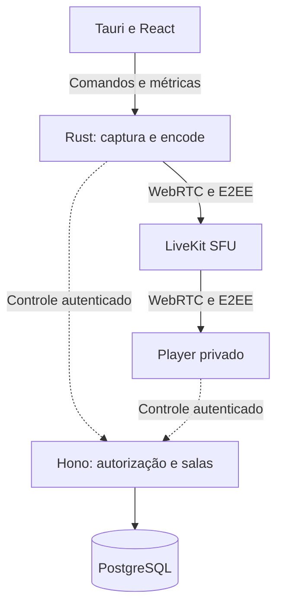

# Plano técnico: compartilhamento de tela privado

- **Versão:** 1.1 — planejamento e contrato do setup inicial.
- **Data da revisão:** 26/10/2026.
- **Status:** M0 implementado com validação local portável; gate Windows/CI pendente. M1–M5 e benchmarks de mídia ainda não executados.
- **Escopo imediato:** bootstrap do repositório, aplicações, arquitetura e infraestrutura local.
- **Escopo do produto:** transmissão privada entre amigos, com baixo impacto no computador e diagnóstico de qualidade.

> Os comandos, diretórios, endpoints e verificações descritos neste arquivo são requisitos para o Codex implementar. Sua presença no plano não significa que já existam ou tenham sido executados. Bitrates, consumo, latência e prazos são propostas a validar.

## 1. Objetivo e premissas

Construir um programa que permita transmitir uma janela ou monitor para amigos autorizados, em 480p, 720p, 1080p e 1440p, a 30 ou 60 FPS. O software deve explicar quando a limitação está na origem, captura, encoder, upload ou reprodução de um espectador.

A primeira beta considera Windows 11 x64 para transmitir, salas de 2 a 8 pessoas e uma transmissão ativa por sala. Neste plano, “2K” significa **QHD/1440p, 2560 × 1440**; a interface deve mostrar a dimensão para eliminar ambiguidade.

O transmissor será um aplicativo desktop. Os espectadores usarão inicialmente um player web privado. A captura permanece nativa, enquanto o receptor aproveita WebRTC do navegador. Player integrado, voz, várias transmissões e macOS/Linux são evoluções posteriores.

Uma transmissão só começa após seleção explícita da fonte e autorização válida. A recuperação de falhas nunca pode selecionar outra janela ou substituir captura de aplicativo por monitor inteiro.

## 2. Decisões tecnológicas

| Camada                | Escolha                         | Responsabilidade                                     |
| --------------------- | ------------------------------- | ---------------------------------------------------- |
| Interface desktop     | Tauri + React + TypeScript      | Controles, sala e diagnóstico                        |
| Núcleo local          | Rust                            | Estado, buffers, captura, encode e integração nativa |
| Captura Windows       | Windows Graphics Capture        | Obter frames da janela ou monitor escolhido          |
| Processamento         | Direct3D 11                     | Escala e conversão de cor na GPU quando suportadas   |
| Encoder inicial       | H.264 por hardware              | Começar pela integração Media Foundation             |
| Transporte            | LiveKit SDK + WebRTC            | Publicação e mecanismos de transporte RTC            |
| Servidor de mídia     | LiveKit SFU                     | Encaminhamento aos espectadores                      |
| Player                | React + LiveKit JavaScript      | Reprodução, E2EE e métricas do receptor              |
| API                   | Node.js LTS + TypeScript + Hono | Identidade, convites, permissões e sessões           |
| Banco                 | PostgreSQL + Drizzle            | Estado de controle e transações                      |
| Desenvolvimento local | Bun, Cargo e Docker Compose     | Builds e execução reproduzíveis                      |

TypeScript e Rust serão as linguagens autorais principais. O SFU pode usar Go internamente sem exigir outro backend em Go. Adaptadores C++ próprios só serão introduzidos se uma integração concreta justificar seu custo.

O Codex deve consultar as fontes oficiais e registrar versões exatas compatíveis: Node LTS suportado, Bun fixado e Rust stable fixado. Não inventar números nem usar tags flutuantes como contrato de reprodução. Tauri, SDKs e imagens também precisam de versões verificadas. Preservar lockfiles e documentar atualizações.

Tauri utiliza WebViews do sistema; isso não comprova baixo consumo. O orçamento precisa incluir todos os subprocessos do produto. [R1]

## 3. Arquitetura de execução

O plano de controle gerencia acesso e estado. O plano de mídia transporta áudio e vídeo. Frames e PCM não atravessam endpoints Hono, filas de jobs, JSON ou estado React.

O SFU permite que o transmissor envie uma cópia de cada qualidade publicada e o servidor distribua aos espectadores. Isso reduz o upload do transmissor, mas preserva o custo de encode local e aumenta a banda de saída da infraestrutura. [R2]

Captura e encode executam fora da thread de UI. Filas devem ser pequenas e limitadas. Um worker separado em processo pode isolar falhas, mas sua necessidade será decidida com medição; o bootstrap não precisa antecipar essa complexidade.

## 4. Arquitetura hexagonal e módulos

Adotar arquitetura hexagonal e monólito modular no backend. O domínio não importa Tauri, Hono, Drizzle, LiveKit ou Win32. Adaptadores implementam fronteiras, e a composição de dependências ocorre na borda da aplicação.

| Camada    | Exemplos                                                                       |
| --------- | ------------------------------------------------------------------------------ |
| Domínio   | `StreamProfile`, `CaptureSelection`, `RoomPolicy`, estados e invariantes       |
| Aplicação | Iniciar/parar compartilhamento, mudar perfil, aceitar convite e revogar membro |
| Entrada   | Comandos Tauri, HTTP e ações da interface                                      |
| Saída     | Captura, encoder, RTC, banco, cofre do SO e métricas                           |

Portas locais previstas: `CaptureSource`, `VideoEncoder`, `AudioEngine`, `RtcTransport`, `SessionKeyProvider`, `CredentialStore` e `MetricsSource`. `QualityAdvisor` deve produzir recomendações explicáveis a partir de evidências.

No backend, usar portas pequenas para identidade, persistência transacional e operações de sessão RTC. Não criar um repositório genérico universal nem tratar cada frame como entidade de negócio.

DTOs de API e IPC ficam nas fronteiras. Entidades Drizzle não são contratos públicos. O compartilhamento de tipos não deve acoplar o domínio Rust à UI ou fazer TypeScript importar detalhes de banco.

## 5. Bootstrap atual — marco M0

### 5.1 Entrega esperada

O setup deve produzir uma base executável com aplicações mínimas, infraestrutura local, configuração validada, migrations, documentação e CI. **Não implementa transmissão, captura real, autenticação definitiva, emissão de tokens de sala ou criptografia de mídia.**

A UI apresenta o catálogo dos oito perfis e o estado real do motor: “ainda não implementado”. Não mostrar valores simulados como medições, nem um selo de E2EE ativa. Qualquer ação de mídia indisponível retorna erro tipado e mantém a publicação bloqueada.

### 5.2 Repositório e diretórios

| Caminho proposto          | Conteúdo                                                                           |
| ------------------------- | ---------------------------------------------------------------------------------- |
| `apps/desktop/`           | React/Vite e configuração do aplicativo desktop                                    |
| `apps/desktop/src-tauri/` | Shell Rust/Tauri, comandos e composição                                            |
| `apps/viewer-web/`        | Player web inicial e estados de indisponibilidade                                  |
| `apps/control-api/`       | API Hono modular, health/readiness e catálogo                                      |
| `crates/domain/`          | Tipos, validações e estados portáveis                                              |
| `crates/application/`     | Coordenação e portas locais                                                        |
| `crates/media-windows/`   | Fronteira Windows, ainda sem captura real                                          |
| `crates/rtc-livekit/`     | Fronteira RTC com implementação indisponível explícita                             |
| `packages/contracts/`     | DTOs e validação de fronteira da API                                               |
| `infra/compose.yaml`      | Infraestrutura e perfil opcional de API em container                               |
| `scripts/`                | Utilitários Node portáveis                                                         |
| `docs/adr/`               | Decisões técnicas com contexto e consequências                                     |
| `docs/`                   | Arquitetura, desenvolvimento, segurança e diagnóstico; `PLAN.md` permanece na raiz |

Usar um workspace bun run na raiz e um workspace Cargo na raiz. O shell `src-tauri` pertence ao workspace Cargo; não criar workspaces Cargo aninhados. Definir membros padrão portáveis para facilitar checks em sistemas sem dependências desktop.

Os adapters nativos devem declarar claramente seu estado. Em plataforma não suportada, retornar `UnsupportedPlatform`; em funcionalidade ainda não construída, `NotImplemented`. Não adicionar o SDK RTC nativo pesado apenas para preencher uma pasta: sua integração pertence à prova de mídia M1.

Inspecionar instruções existentes antes de alterar o repositório. Inicializar Git somente se necessário. Preservar alterações do usuário e não criar remotos, publicar código ou reescrever histórico sem instrução específica.

### 5.3 API e persistência mínimas

Implementar:

- `GET /healthz`: liveness real do processo.
- `GET /readyz`: configuração válida e acesso real ao PostgreSQL, com timeout e esquema esperado aplicado.
- `GET /v1/video-profiles`: catálogo estático validado dos oito perfis.

O catálogo descreve opções do produto. Ele não afirma que o computador suporta os perfis nem que houve teste de rede.

Criar uma migration versionada mínima para a estrutura inicial de `rooms`, documentando campos e evolução para identidade/autorização. Não expor endpoints de criação ou edição de salas no bootstrap. Não usar `db push` como substituto do histórico de migrations.

Rotas de identidade, autorização e participação futuras permanecem ausentes ou negam acesso por padrão. Não criar login falso ou endpoint que emita JWT arbitrário para “facilitar” a demonstração.

Readiness da API não significa que ICE, UDP, codec ou E2EE funcionam. Relatar separadamente o que foi efetivamente verificado.

### 5.4 Docker Compose local

Serviços padrão: **PostgreSQL e LiveKit**. Perfil `app`: serviço de migration e API em container. UI e desktop executam no host. Redis e TURN não serão implementados em M0; documentar sua adoção futura e as restrições do desenvolvimento local.

Portas publicadas devem ficar em `127.0.0.1` por padrão. Banco e API administrativa não podem ser expostos à LAN por conveniência. Uma futura configuração LAN será explícita e terá autorização, TLS e configuração RTC própria.

Separar endereços internos dos containers, endereços usados por processos no host e endereço de conexão entregue ao navegador. Não presumir que `localhost` dentro de um container representa o host.

Escolher configuração efetiva suportada pelo LiveKit. Não assumir que o Compose expande variáveis dentro de qualquer YAML montado. O bootstrap pode gerar um arquivo local ignorado pelo Git, sem imprimir seu conteúdo secreto.

Usar healthchecks compatíveis com os binários realmente presentes nas imagens. Não inventar comandos `curl`, shells ou endpoints. No perfil `app`, executar as migrations atuais a cada `stack:up`, sem confiar em um container antigo concluído; falha de migration não pode iniciar uma aplicação aparentemente pronta.

Containers da API devem ter build reproduzível, usuário sem privilégios e contexto que exclua segredos. Volumes persistem entre reinícios; o caminho de persistência/`PGDATA` deve corresponder à versão PostgreSQL fixada. Validar essa propriedade em ambiente descartável. Encerrar o ambiente não apaga os dados.

O smoke verifica o controle do LiveKit com chamada autenticada somente de leitura, timeout e saída saneada, sem revelar conteúdo de salas ou segredos. Não exige emissão pública de tokens e não comprova mídia RTC. O smoke normal não reinicia o banco de desenvolvimento.

### 5.5 Contrato de comandos

Estes nomes devem ser implementados e documentados pelo Codex:

| Comando                 | Responsabilidade proposta                                        |
| ----------------------- | ---------------------------------------------------------------- |
| `bun run bootstrap`     | Preparar configuração local sem sobrescrever arquivos existentes |
| `bun run doctor`        | Verificar versões, ferramentas, configuração e pré-requisitos    |
| `bun run infra:up`      | Iniciar PostgreSQL e LiveKit locais                              |
| `bun run infra:down`    | Encerrar infraestrutura sem apagar volumes                       |
| `bun run db:migrate`    | Aplicar migrations versionadas                                   |
| `bun run dev`           | Executar API e viewer no host                                    |
| `bun run dev:desktop`   | Iniciar o desktop no sistema suportado                           |
| `bun run stack:up`      | Iniciar infraestrutura e perfil `app`, incluindo migration       |
| `bun run stack:down`    | Encerrar o stack sem apagar volumes                              |
| `bun run check:ts`      | Formatação/lint, tipos, testes relevantes e builds TS            |
| `bun run check:rust`    | Fmt, clippy e testes dos crates portáveis                        |
| `bun run check`         | Agregar verificações suportadas, com falhas explícitas           |
| `bun run smoke`         | Verificar os comportamentos reais disponibilizados em M0         |
| `bun run build:desktop` | Construir o desktop em Windows com pré-requisitos válidos        |

Os modos API no host e API no container são alternativas; documentar conflitos de porta. Não criar `db:reset` nesta entrega. Se necessário no futuro, ele será uma ação destrutiva explícita, separada dos comandos normais.

Scripts TypeScript/Bun devem funcionar em Windows sem depender de Bash. `doctor` informa pré-requisitos ausentes; não eleva privilégios ou instala toolchains silenciosamente.

### 5.6 Configuração, documentação e CI

Gerar segredos locais com fonte criptográfica, manter arquivos reais ignorados e versionar apenas exemplos sem valores utilizáveis em produção. Não colocar credenciais em variáveis `VITE_*`, argumentos registrados em logs ou bundles frontend.

O README deve explicar pré-requisitos, comandos, URLs/portas, modos de execução, migrations, troubleshooting e o que ainda não funciona. `AGENTS.md` deve registrar limites arquiteturais, privacidade, comandos de validação e proibição de apresentar placeholders como funcionalidades prontas.

CI: TypeScript e integração PostgreSQL em Linux; Rust portável em ambiente adequado; compilação do shell/adapters Windows em Windows. Não executar indiscriminadamente todo o workspace nativo em Linux. Assinatura de distribuição permanece pendente; um build de desenvolvimento não pode ser anunciado como assinado.

Checklist de aceitação de M0:

- [x] Configuração reproduzível e versões exatas registradas.
- [x] Workspaces Bun/Cargo e dependências com direção correta.
- [x] Infraestrutura inicia apenas com exposição local prevista.
- [x] Migrations e readiness funcionam de verdade.
- [x] Catálogo contém oito perfis sem alegar capacidade detectada.
- [x] UI deixa indisponibilidade de mídia e E2EE explícita.
- [x] README permite executar o ambiente a partir de um clone.
- [x] Relatório final distingue checks executados, falhas e bloqueios do ambiente.

**Evidências do setup (26/10/2026):** consultar [docs/validation.md](docs/validation.md). Neste ambiente, o viewer usa 5175 no `.env` local porque 5173/5174 pertencem a outros projetos. O comando de diagnóstico vigente é `bun run doctor`.

- [ ] Gate Windows: executar shell, testes IPC e bundle NSIS no Windows 11 x64. A checagem/teste do shell no macOS não valida esse gate.
- [ ] Executar os workflows GitHub Actions no provedor; configuração versionada não equivale a CI executada.

**Atualização das convenções do M0:** frontend reorganizado por feature conforme o projeto Truco; scripts autorais em TypeScript executados por Bun; regras de Biome/imports, cobertura de 80% de linhas/funções por arquivo e E2E desktop/mobile implementadas. `bun run check` agora inclui cobertura com banco descartável e exige Docker; `check:ts`/`check:rust` permanecem verificações parciais sem Docker. Ver `docs/frontend.md`, `docs/testing.md` e ADR 0006. Isso não inicia M1.

## 6. Prova técnica da mídia — M1

O caminho proposto é WGC → textura D3D11 → escala/conversão na GPU → H.264 por hardware → access units → LiveKit/WebRTC. A documentação Microsoft fornece as APIs; sua composição eficiente é desenvolvimento do projeto. [R3] [R4]

O LiveKit Rust suporta Windows como plataforma, mas a lista documentada de aceleração consultada não demonstra encoder/decoder Windows pronto. A publicação pré-codificada é uma rota existente e exige aplicar feedback de bitrate/FPS e pedidos de keyframe ao encoder externo. [R5] [R6]

Na revisão de 26/10/2026, a proposta de recepção pré-codificada no SDK Rust permanecia em andamento. Revalidar antes de implementar; não depender de um decoder Windows customizado como integração já disponível. O player web também precisa provar decode e reprodução eficientes. [R7]

M1 deve usar dois computadores reais, E2EE ligada e o jogo que apresenta o problema. Medir encode, cópias, filas, impacto no jogo, recepção e recuperação antes de consolidar a arquitetura de mídia.

## 7. Alt+Tab, captura e áudio

Separar perda de foco, minimização, redução de FPS pelo jogo, mudança de modo e saturação de GPU. Se o jogo para de renderizar em segundo plano, o software não pode produzir frames novos em seu lugar.

Recuperar recursos invalidados, retomar a mesma origem e solicitar keyframe quando necessário. DXGI prevê perda de acesso em mudanças de modo/fullscreen; o código WGC do libwebrtc trata condições de origem não capturável. [R8] [R9]

Manter indicador de compartilhamento e controles responsivos. Fonte fechada ou inacessível causa pausa com explicação. Nunca trocar silenciosamente para monitor inteiro.

Capturar áudio do aplicativo quando possível, evitando retransmitir a chamada recebida dos amigos. Loopback por processo tem requisitos de Windows e precisa de testes em aplicações multiprocesso. Áudio do sistema inteiro é uma opção explícita, não fallback oculto. [R10]

## 8. Perfis, bitrate e adaptação

Faixas iniciais propostas para H.264 com movimento, sujeitas a cena, hardware, preset e avaliação visual:

| Resolução | Dimensões   | 30 FPS     | 60 FPS     |
| --------- | ----------- | ---------- | ---------- |
| 480p      | 854 × 480   | 1–2 Mbps   | 1,5–3 Mbps |
| 720p      | 1280 × 720  | 2,5–4 Mbps | 4–6 Mbps   |
| 1080p     | 1920 × 1080 | 4–8 Mbps   | 8–12 Mbps  |
| 1440p     | 2560 × 1440 | 8–14 Mbps  | 14–24 Mbps |

Reservar inicialmente 25–35% de margem de rede para variação, protocolos, áudio e retransmissões. Avaliar a rota até o SFU, não apenas um speed test externo.

Para jogos, preferir fluidez e reduzir resolução antes de FPS. Para texto, preservar detalhe e favorecer 30 FPS. O modo manual define metas, mas não desativa o controle de congestionamento.

WebRTC controla bitrate/pacing rapidamente. O aplicativo muda perfil lentamente, com histerese: como hipótese inicial, degradar após 5–10 segundos de pressão e subir após 20–30 segundos de folga. Fila perigosa permite reação imediata.

O caminho pré-codificado documentado publica uma camada espacial. Na beta, a qualidade é comum. O SFU não fabrica 480p a partir de um único stream 1440p; qualidade independente exige outra camada/encode ou integração validada, aumentando custo. [R6]

## 9. Métricas e recomendações

Medir origem/captura, conversão, encode, envio e reprodução por espectador. FPS alvo não equivale a FPS codificado ou apresentado. O publicador pode ter upload estável enquanto um espectador sofre com download ou decode.

O painel recebe amostras por segundo; decisões usam janelas móveis. Receptores enviam relatórios compactos e privados a cada 2–5 segundos. Campos ausentes são “não disponível”; não inferir GPU saturada apenas de CPU total ou `qualityLimitationReason`. [R11] [R12]

Calcular deltas de contadores no mesmo stream e reiniciar baseline após reconexão. Não somar FPS de camadas diferentes. Tempo acumulado permite média; p95 exige amostras/histogramas. No encoder externo, instrumentar o estágio real. [R13]

Tela estática pode gerar poucas atualizações legitimamente. Correlacionar atividade da origem antes de declarar travamento. RTT mede um trecho; latência visual deve ser validada de captura a apresentação.

As recomendações são regras explicáveis: “origem sem atualização”, “encoder limitado”, “upload instável” ou “receptor limitado”. O bootstrap M0 não exibe essas conclusões como se medições já existissem.

## 10. Desempenho e testes de referência

Manter processamento na GPU quando suportado, reutilizar buffers e limitar filas. Não mover vídeo por JSON/base64 ou criar encodes duplicados. “Zero-copy” é resultado a medir. Encoder dedicado não elimina disputa por GPU e memória; o jogo pode precisar deixar margem. [R14]

Metas iniciais propostas, não medições:

| Indicador    | Critério de investigação                                                      |
| ------------ | ----------------------------------------------------------------------------- |
| Cadência     | Pelo menos 95% do alvo em janelas de 10 s com movimento e fonte suficiente    |
| Jogo         | Investigar impacto de até 5–10% em FPS, 1% low e frame times equivalentes     |
| CPU          | Média até 5% da máquina de referência de 6 núcleos/12 threads                 |
| RAM          | Orçamento inicial de 250 MiB ocioso e 500 MiB em 1080p60                      |
| Alt+Tab      | 100 ciclos; retomada p95 abaixo de 2 s após a origem voltar a produzir frames |
| Latência     | Investigar p95 abaixo de 400 ms em rede controlada e documentada              |
| Estabilidade | Duas horas sem crescimento sustentado de memória, fila ou atraso              |

Incluir subprocessos, medir memória compartilhada sem dupla contagem e registrar VRAM separadamente. Testar NVIDIA, AMD, Intel integrada, notebook híbrido, múltiplos monitores, HDR, lock/unlock e troca de áudio.

Rede: UDP, futuro TURN, TCP/TLS, banda oscilante, upload concorrente, 1–3% de perda, jitter e reconexão. Receptor: foreground, segundo plano, tela cheia e economia de energia. Não declarar aprovado um cenário não executado.

## 11. Privacidade e autorização do produto

Salas terão autenticação estabelecida, convites aleatórios expiráveis/revogáveis, aprovação, permissões mínimas e participantes visíveis. IDs opacos evitam incorporar e-mail ou nome real em identificadores técnicos.

TLS/WebRTC protegem o transporte. Para impedir leitura de conteúdo pelo SFU, exigir E2EE em todos os clientes e falhar sem publicação se a configuração estiver inválida. Sinalização e APIs continuam visíveis ao servidor. Validar a configuração moderna de criptografia para mídia e dados. [R15]

JWT de acesso e chave de mídia são segredos diferentes. Se o serviço não deve conhecer a chave, ela nasce no dispositivo do host e é distribuída apenas aos membros autorizados. Na beta, distribuição manual por canal E2EE existente é aceitável com custo de experiência declarado. Automatização exige protocolo/biblioteca revisado; não criar criptografia própria. [R16]

Não armazenar gravações, screenshots, thumbnails ou transcrição. Logs não incluem tokens, chaves, convites, títulos de janelas, URLs abertas ou buffers de mídia. Métricas detalhadas ficam locais; relatórios de suporte são voluntários e saneados.

O serviço ainda observa IPs, horários e volume. Participantes autorizados podem gravar sua tela. O player web confia no código entregue pelo serviço. E2EE não protege contra dispositivo comprometido ou cliente alterado para roubar chaves.

## 12. Sessões, epochs e revogação

Modelar sala lógica estável e sessão RTC descartável. `MediaSession` possui epoch crescente, nome SFU aleatório e estados de preparação/atividade/encerramento. Não persistir a chave de conteúdo no banco.

No self-hosted, remover participante não invalida imediatamente seu JWT existente; há renovação de tokens durante a conexão. TTL curto não resolve sozinho a revogação estrita. [R17]

Fluxo proposto: revogar membership em transação, pausar publicação, criar nova sessão e segredo independente, entregar novos grants/chave apenas aos autorizados e retomar. Tokens antigos passam a apontar para uma sessão sem a mídia atual.

Não enviar a chave nova usando apenas o segredo antigo, conhecido pelo removido. Serializar mudanças, ignorar epochs anteriores e consultar snapshot antes de republicar após reconexão. Outbox pode recuperar falhas entre commit e chamada RTC. Se alguém já recebeu uma chave candidata e for removido, abandonar essa candidata.

Testar cliente modificado com token/chave antigos, entrada simultânea à expulsão e perda de eventos. Nenhum endpoint desse fluxo é disponibilizado por M0 sem autorização real.

## 13. Infraestrutura futura e custos

Após o spike local, validar uma VM Linux próxima do grupo por latência real. Começar com uma hipótese de 2–4 vCPU e 4–8 GB de RAM, ajustando por banda e pacotes por segundo. O SFU apenas encaminha a mídia e não exige GPU para essa função. Qualidades menores são produzidas pelo transmissor no desenho proposto.

TURN autenticado entra quando forem testadas redes restritivas. Seguir a documentação de TLS, portas e roteamento; proxy HTTP não encaminha automaticamente UDP. Redis será introduzido quando a topologia ou requisito operacional justificar. Não anunciar o Compose local de M0 como implantação de produção. [R18] [R19]

Saída aproximada de payload em GB decimais por hora:

`GB/h = bitrate em Mbps × 0,45 × espectadores`

Uma live de 10 Mbps para quatro espectadores consome aproximadamente 18 GB/h de saída. Três horas por dia durante 30 dias equivalem a 1,62 TB. Somar áudio, cabeçalhos, retransmissões e trajetos cobrados de relay.

Escolher provedor por franquia, excedente, throughput e latência, além de CPU/RAM. Essas contas não são cotação de fornecedor. Não presumir que um plano gratuito comporta uso frequente em 1440p60.

## 14. Marcos, entregas e critérios de avanço

| Marco                   | Entrega                                                   | Gate                                              |
| ----------------------- | --------------------------------------------------------- | ------------------------------------------------- |
| M0 — Bootstrap          | Repositório, shells, API mínima, Compose, migrations e CI | Clone executável, sem alegações de mídia pronta   |
| M1 — Prova de mídia     | Captura, encoder, transporte, viewer e E2EE em dois PCs   | Evidência de hardware, feedback e recuperação     |
| M2 — Produto privado    | Identidade, convites, grants e infraestrutura real        | Acesso indevido bloqueado e conectividade testada |
| M3 — Captura utilizável | Oito perfis, áudio, pausa e recovery                      | Fonte preservada e sobrecarga limitada            |
| M4 — Diagnóstico        | Relatórios e recomendação automática                      | Gargalos diferenciados e adaptação estável        |
| M5 — Beta distribuída   | Revogação, migração, instalador e updates                 | Segurança de sessão e testes prolongados          |

M0 prepara o trabalho. M1 valida a viabilidade antes de ampliar a implementação do produto. Segurança não fica para depois da disponibilização aos amigos: autorização e E2EE são requisitos da beta.

Estimativa inicial para a beta: 12–20 semanas com dois desenvolvedores, um experiente em mídia/Windows. Para uma pessoa aprendendo essas áreas, considerar 4–8 meses ou mais. M1 pode alterar o orçamento. Não transformar essa estimativa em promessa de prazo do bootstrap.

## 15. Riscos e decisões a registrar

- Compatibilidade entre GPU, encoder, perfil H.264 e receptor: provar em M1.
- Consumo do WebView e do player: medir todos os processos.
- APIs nativas em evolução: revalidar suporte antes de depender delas.
- Qualidade por espectador: preservar a limitação de uma camada na beta.
- Chaves e revogação: declarar a experiência manual inicial e sua evolução.
- Multi-OS: criar adaptadores sem prometer suporte que não foi testado.
- Publicação/assinatura/licença: registrar decisões necessárias antes de distribuição ampla.

ADRs iniciais esperadas: stack e versões; Windows/transmissor versus viewer web; hexagonal e fronteiras; uma camada por transmissão; execução local/Compose; modelo de ameaça e chaves; critérios de avanço do spike.

O primeiro resultado importante após o setup é uma transmissão privada de 1080p60, com métricas confiáveis e Alt+Tab reproduzível. Esse resultado determina o investimento nas etapas seguintes.

## Referências primárias

As capacidades foram revisadas em 26/10/2026. O Codex deve revalidar versões e APIs na implementação. As propostas de produto, faixas e metas acima são decisões de engenharia.

- **[R1]** [Tauri, modelo de processos](https://v2.tauri.app/concept/process-model/)
- **[R2]** [LiveKit, arquitetura SFU](https://docs.livekit.io/reference/internals/livekit-sfu/)
- **[R3]** [Microsoft, Windows Graphics Capture](https://learn.microsoft.com/en-us/windows/apps/develop/media-authoring-processing/screen-capture)
- **[R4]** [Microsoft, Hardware MFTs](https://learn.microsoft.com/en-us/windows/win32/medfound/hardware-mfts)
- **[R5]** [LiveKit Rust SDK](https://github.com/livekit/rust-sdks)
- **[R6]** [LiveKit, publicação pré-codificada](https://docs.livekit.io/transport/media/pre-encoded/)
- **[R7]** [LiveKit Rust, recepção pré-codificada em discussão](https://github.com/livekit/rust-sdks/issues/1514)
- **[R8]** [Microsoft, AcquireNextFrame](https://learn.microsoft.com/en-us/windows/win32/api/dxgi1_2/nf-dxgi1_2-idxgioutputduplication-acquirenextframe)
- **[R9]** [libwebrtc, captura WGC](https://webrtc.googlesource.com/src/+/refs/heads/main/modules/desktop_capture/win/wgc_capture_session.cc)
- **[R10]** [Microsoft, áudio por processo](https://learn.microsoft.com/en-us/samples/microsoft/windows-classic-samples/applicationloopbackaudio-sample/)
- **[R11]** [W3C, estatísticas WebRTC](https://www.w3.org/TR/webrtc-stats/)
- **[R12]** [libwebrtc, estatísticas de vídeo](https://webrtc.googlesource.com/src/+/refs/heads/main/video/g3doc/stats.md)
- **[R13]** [Chrome, getStats](https://developer.chrome.com/blog/getstats-migration)
- **[R14]** [OBS, desempenho de encoding](https://obsproject.com/kb/encoding-performance-troubleshooting)
- **[R15]** [LiveKit, criptografia](https://docs.livekit.io/transport/encryption/)
- **[R16]** [LiveKit, configuração de E2EE](https://docs.livekit.io/transport/encryption/start/)
- **[R17]** [LiveKit, tokens e revogação](https://docs.livekit.io/frontends/reference/tokens-grants/)
- **[R18]** [LiveKit, implantação](https://docs.livekit.io/transport/self-hosting/deployment/)
- **[R19]** [LiveKit, portas e firewall](https://docs.livekit.io/transport/self-hosting/ports-firewall/)

Fontes para verificar o bootstrap:

- [Node.js, versões e ciclo de suporte](https://nodejs.org/en/about/previous-releases)
- [Bun, workspaces](https://bun.sh/docs/pm/workspaces)
- [Cargo, workspaces](https://doc.rust-lang.org/cargo/reference/workspaces.html)
- [Tauri, pré-requisitos](https://v2.tauri.app/start/prerequisites/)
- [Hono, Node.js](https://hono.dev/docs/getting-started/nodejs)
- [Docker Compose, rede](https://docs.docker.com/compose/how-tos/networking/)

## Atualização de ferramentas — 26/10/2026

Bun 1.4.3 adotado como gerenciador/workspaces e runtime de ferramentas após benchmark e validação da suíte completa. Vitest e cobertura por arquivo foram preservados; Vite/Playwright e scripts usam Bun. `bun.lock` substitui o lockfile pnpm; `package.json` declara workspaces. A API publicada continua em Node 24.22.1, inclusive nos E2E; Docker usa Bun nos estágios de instalação/build e Node no runtime final. A ADR 0007 registra evidências e limites. Não altera escopo de mídia M1–M5.

## Atualização do runner — 26/10/2026

Bun Test nativo substituiu Vitest após avaliação solicitada pelo usuário. Foram preservados os cenários existentes, os limites de cobertura por arquivo e o inventário; processos backend/DOM são isolados e os relatórios são LCOV/HTML/JSON. A comparação de tempo ficou equivalente; a adoção simplifica a stack e não promete aceleração adicional. Ver ADR 0008. Playwright e o runtime Node de produção permanecem.
