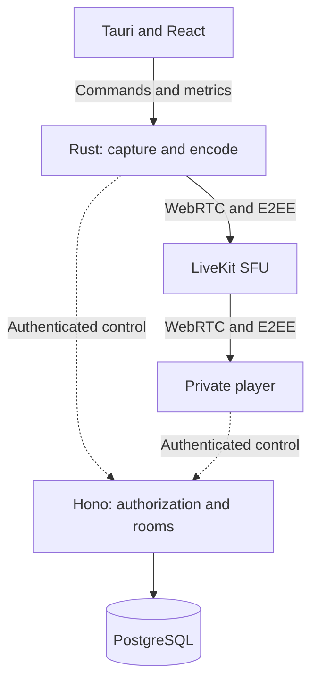

# Technical plan: private screen sharing

- **Version:** 1.1 — initial planning/setup contract.
- **Review date:** 2026-10-26.
- **Status:** M0 implemented with portable local validation and passing provider CI (including Windows build/IPC). M1 implementation has started; its Windows hardware/two-PC gate and M2–M5 remain pending.
- **Current development scope:** M1 media proof and its explicit advancement gates; M0 remains the executable foundation.
- **Product scope:** private streaming among friends, low computer overhead, quality diagnostics.

> Commands, paths, endpoints, and checks below are implementation requirements. Their presence does not mean they exist or have run. Bitrates, resource budgets, latency, and schedules are hypotheses to validate.

## 1. Goal and assumptions

Build software that shares a selected window/monitor with authorized friends at 480p, 720p, 1080p, and 1440p, each at 30/60 FPS. It should explain whether the bottleneck is the source, capture, encoder, upload, or a viewer's playback.

Initial beta targets Windows 11 x64 publishers, rooms of 2–8 people, and one active stream per room. Here, 2K means **QHD/1440p, 2560 × 1440**; show dimensions to avoid ambiguity.

Publisher is a desktop application; viewers initially use a private web player. Capture stays native while reception uses browser WebRTC. Integrated player, voice, multiple streams, macOS/Linux are later work.

Streaming starts only after explicit source selection and valid authorization. Recovery must never select another window or replace application capture with full-monitor capture.

## 2. Technology decisions

| Layer             | Choice                         | Responsibility                                        |
| ----------------- | ------------------------------ | ----------------------------------------------------- |
| Desktop UI        | Tauri + React + TypeScript     | Controls, room, diagnostics                           |
| Local core        | Rust                           | State, buffers, capture, encoding, native integration |
| Windows capture   | Windows Graphics Capture       | Frames from the selected window/monitor               |
| Processing        | Direct3D 11                    | GPU scaling/color conversion where supported          |
| Initial encoder   | Hardware H.264                 | Start with Media Foundation integration               |
| Transport         | LiveKit SDK + WebRTC           | Publication/RTC transport mechanisms                  |
| Media server      | LiveKit SFU                    | Forward streams to viewers                            |
| Player            | React + LiveKit JavaScript     | Playback, E2EE, receiver metrics                      |
| API               | Bun + strict TypeScript + Hono | Identity, invites, permissions, sessions              |
| Database          | PostgreSQL + Drizzle           | Control state/transactions                            |
| Local development | Bun, Cargo, Docker Compose     | Reproducible builds/execution                         |

TypeScript/Rust are the main authored languages. SFU internals may use Go without requiring a separate Go backend. Custom C++ adapters require a concrete integration benefit justifying maintenance cost.

Consult official sources and record exact compatible versions: pinned supported Bun, pinned stable Rust, Tauri, SDKs, images. Never invent versions or use floating tags as a reproducibility contract. Preserve lockfiles and document updates.

Tauri uses system WebViews; that does not prove low overhead. Budgets must include every product subprocess. [R1]

## 3. Runtime architecture

Control manages access/state; media carries audio/video. Frames/PCM must not cross Hono endpoints, job queues, JSON, or React state.

SFU lets the publisher upload one copy per published quality and distributes it to viewers, reducing publisher upload while preserving local encoding cost and increasing infrastructure egress. [R2]

Capture/encoding run outside the UI thread. Queues stay small/bounded. Process isolation may help fault containment but requires measurement; bootstrap need not anticipate it.

## 4. Hexagonal architecture and modules

Use hexagonal architecture and a modular API monolith. Dependencies point inward: domain imports no Tauri, Hono, Drizzle, LiveKit, or Win32. Adapters implement boundaries; edge composition wires dependencies.

| Layer       | Examples                                                             |
| ----------- | -------------------------------------------------------------------- |
| Domain      | StreamProfile, CaptureSelection, RoomPolicy, states/invariants       |
| Application | Start/stop sharing, change profile, accept invite, revoke membership |
| Inbound     | Tauri commands, HTTP, UI actions                                     |
| Outbound    | Capture, encoder, RTC, database, OS credential vault, metrics        |

Proposed local ports: CaptureSource, VideoEncoder, AudioEngine, RtcTransport, SessionKeyProvider, CredentialStore, MetricsSource. QualityAdvisor provides explainable recommendations from evidence.

Backend ports stay small for identity, transactional persistence, and RTC session operations. Do not create a universal generic repository or model each frame as a business entity.

API/IPC DTOs belong at boundaries. Drizzle entities are not public contracts. Shared types must not couple Rust domain to UI or make TypeScript import database internals.

## 5. Current bootstrap: M0

### 5.1 Expected delivery

Provide an executable foundation with minimal apps, local infrastructure, validated configuration, migrations, docs, and CI. **It does not implement streaming, real capture, definitive authentication, room-token issuance, or media encryption.**

UI shows eight profiles and the engine's real unimplemented state. Never present simulated values as measurements or an active-E2EE badge. Unavailable media actions return typed errors and keep publication blocked.

### 5.2 Repository and paths

| Proposed path           | Content                                                                 |
| ----------------------- | ----------------------------------------------------------------------- |
| apps/desktop/           | React/Vite and desktop configuration                                    |
| apps/desktop/src-tauri/ | Rust/Tauri shell, commands, composition                                 |
| apps/viewer-web/        | Initial web player/unavailable states                                   |
| apps/control-api/       | Modular Hono API, health/readiness, catalog                             |
| crates/domain/          | Portable types/validation/states                                        |
| crates/application/     | Coordination/local ports                                                |
| crates/media-windows/   | Windows boundary, no real capture yet                                   |
| crates/rtc-livekit/     | Explicitly unavailable RTC implementation                               |
| packages/contracts/     | API DTOs/boundary validation                                            |
| infra/compose.yaml      | Infrastructure/optional container API profile                           |
| scripts/                | Portable TypeScript/Bun utilities                                       |
| docs/adr/               | Technical decisions with context/consequences                           |
| docs/                   | Architecture, development, security, diagnostics; PLAN.md stays at root |

One root Bun workspace and one root Cargo workspace; src-tauri belongs to Cargo workspace, with no nested workspaces. Portable default-members simplify checks without desktop dependencies.

Native adapters declare their actual state: UnsupportedPlatform for unsupported OS, NotImplemented for unbuilt features. Do not install a heavy native RTC SDK merely to populate a folder; its integration belongs to M1.

Inspect existing instructions/work before editing. Initialize Git only when necessary. Preserve user changes; no remotes, publication, or history rewrite without specific instruction.

### 5.3 Minimal API and persistence

Implement:

- GET /healthz: real process liveness.
- GET /readyz: valid configuration, real PostgreSQL access, timeout, expected schema applied.
- GET /v1/video-profiles: validated static eight-profile catalog.

Catalog describes product options, not detected computer support or tested networking.

Create a minimal versioned rooms migration with documented fields and future identity/authorization evolution. Bootstrap has no room creation/editing endpoints. Never replace migration history with db push.

Future identity/authorization/membership routes remain absent or deny by default. Never create fake login or arbitrary JWT issuance for a demonstration.

Readiness does not establish ICE, UDP, codec, or E2EE functionality. Report each verified property separately.

### 5.4 Local Docker Compose

Default services: **PostgreSQL and LiveKit**. App profile adds one-shot migration and container API. UI/desktop run on host. No Redis/TURN in M0; document future adoption/local limitations.

Published ports bind 127.0.0.1 by default. Do not expose database/administrative APIs to LAN for convenience. Future LAN setup is explicit with authorization, TLS, and RTC configuration.

Separate container-internal addresses, host-process addresses, and browser connection URLs. Localhost inside a container is not the host.

Use actual supported LiveKit configuration. Do not assume Compose expands variables in arbitrary mounted YAML. Bootstrap may generate an ignored local file without printing secrets.

Healthchecks must use binaries/endpoints present in images, not invented curl/shell commands. Each stack:up applies current migrations, ignoring stale completed migrator containers; migration failure must not start an apparently ready API.

API images require reproducible builds, unprivileged runtime, and secret-free contexts. Volumes persist across restarts; persistence paths/PGDATA match pinned PostgreSQL major version. Prove persistence in a disposable environment. Shutdown preserves data.

Smoke uses authenticated read-only LiveKit control, timeout, sanitized output, no room content/secrets. It neither needs public token issuance nor proves RTC media nor restarts development database.

### 5.5 Command contract

| Command               | Responsibility                                        |
| --------------------- | ----------------------------------------------------- |
| bun run bootstrap     | Prepare local configuration without overwriting files |
| bun run doctor        | Check versions, tools, configuration, prerequisites   |
| bun run infra:up      | Start local PostgreSQL/LiveKit                        |
| bun run infra:down    | Stop infrastructure without deleting volumes          |
| bun run db:migrate    | Apply versioned migrations                            |
| bun run dev           | Host API/viewer                                       |
| bun run dev:desktop   | Desktop on supported OS                               |
| bun run stack:up      | Infrastructure/app profile including migration        |
| bun run stack:down    | Stop stack, preserve volumes                          |
| bun run check:ts      | Formatting/lint, types, relevant tests, TS builds     |
| bun run check:rust    | Portable fmt/clippy/tests                             |
| bun run check         | Aggregate supported checks, fail explicitly           |
| bun run smoke         | Check actual M0 behavior                              |
| bun run build:desktop | Windows build with required prerequisites             |

Host/container API modes are alternatives; document port conflicts. Do not add db:reset here. Any future destructive reset is separate and explicit.

TypeScript/Bun scripts work on Windows without Bash. Doctor reports missing prerequisites, never silently elevates privileges or installs toolchains.

### 5.6 Configuration, documentation, CI

Generate local secrets from a cryptographic source. Ignore effective files; version examples without production-usable secrets. Never put credentials in VITE variables, logged arguments, or frontend bundles.

README explains prerequisites, commands, URLs/ports, execution modes, migrations, troubleshooting, unavailable features. AGENTS.md records boundaries, privacy, checks, and prohibition on presenting placeholders as working features. Documentation, code, comments, and developer-facing test descriptions use English; existing product UI and user conversations retain their language unless requested otherwise.

CI separates Linux TS/PostgreSQL integration, portable Rust, and Windows shell/adapters. Do not indiscriminately build the entire native workspace on Linux. Distribution signing remains pending; development builds are not signed releases.

M0 acceptance checklist:

- [x] Reproducible configuration/exact versions recorded.
- [x] Bun/Cargo workspaces and correct dependencies.
- [x] Infrastructure publishes only intended local access.
- [x] Real migrations/readiness.
- [x] Eight-profile catalog without detected-capability claims.
- [x] UI explicitly marks media/E2EE unavailable.
- [x] README supports execution from a clone.
- [x] Report distinguishes executed checks, failures, and blockers.

**Setup evidence (2026-10-26):** see [docs/validation.md](docs/validation.md). Local viewer uses 5175 because other projects own 5173/5174. Current diagnostic command: bun run doctor.

- [ ] Windows gate: shell execution, IPC tests, NSIS bundle on Windows 11 x64. macOS shell checks/tests do not validate this gate.
- [x] Run GitHub Actions in the provider: CI run 40432835471 passed all four jobs, including Windows IPC/NSIS build. This does not prove interactive Windows 11 capture.

**M0 convention update:** feature-based frontend adapted from Truco; TypeScript/Bun scripts; Biome/import rules; 80% per-file lines/functions coverage; desktop/mobile E2E. bun run check includes disposable-database coverage/Docker; partial check:ts/check:rust remain independent of Docker. See docs/frontend.md, docs/testing.md, ADR 0006. This does not start M1.

## 6. Media technical proof: M1

Proposed path: WGC → D3D11 texture → GPU scaling/conversion → hardware H.264 → access units → LiveKit/WebRTC. Microsoft documents APIs; efficient composition is project engineering work. [R3] [R4]

LiveKit Rust supports Windows as a platform, but reviewed acceleration documentation does not demonstrate a ready Windows encoder/decoder. Pre-encoded publication exists and requires applying bitrate/FPS feedback/keyframe requests to the external encoder. [R5] [R6]

At the 2026-10-26 review, Rust SDK pre-encoded reception was still under discussion. Revalidate before implementation; do not assume an existing custom Windows decoder integration. Web player must also prove efficient decode/playback. [R7]

M1 uses two real PCs, E2EE enabled, and the game exhibiting the issue. Measure encoding, copies, queues, game impact, reception, and recovery before committing to media architecture.

## 7. Alt+Tab, capture, audio

Distinguish focus loss, minimization, reduced game FPS, mode changes, and GPU saturation. If the game stops rendering in background, this software cannot create new source frames.

Recover invalidated resources, resume the same source, request a keyframe as needed. DXGI anticipates access loss on mode/fullscreen changes; libwebrtc WGC handles uncapturable sources. [R8] [R9]

Keep sharing indicators/controls responsive. Closed/inaccessible sources pause with explanation. Never silently switch to a full monitor.

Capture application audio where possible without retransmitting friends' incoming call audio. Per-process loopback has Windows requirements and needs multiprocess-app tests. System-wide audio is an explicit option, never a hidden fallback. [R10]

## 8. Profiles, bitrate, adaptation

Initial proposed H.264 motion ranges, subject to scene, hardware, preset, and visual assessment:

| Resolution | Dimensions  | 30 FPS     | 60 FPS     |
| ---------- | ----------- | ---------- | ---------- |
| 480p       | 854 × 480   | 1–2 Mbps   | 1.5–3 Mbps |
| 720p       | 1280 × 720  | 2.5–4 Mbps | 4–6 Mbps   |
| 1080p      | 1920 × 1080 | 4–8 Mbps   | 8–12 Mbps  |
| 1440p      | 2560 × 1440 | 8–14 Mbps  | 14–24 Mbps |

Initially reserve 25–35% network margin for variability, protocols, audio, retransmission. Evaluate the SFU path, not only an external speed test.

Games prioritize fluidity and reduce resolution before FPS. Text prioritizes detail/30 FPS. Manual settings define targets without disabling congestion control.

WebRTC controls bitrate/pacing quickly; application changes profiles slowly with hysteresis. Initial hypothesis: degrade after 5–10s pressure, upgrade after 20–30s headroom; dangerous queues allow immediate reaction.

Documented pre-encoded publication has one spatial layer. Beta quality is common to viewers. SFU cannot manufacture 480p from one 1440p stream; independent quality requires another layer/encode or validated integration, increasing cost. [R6]

## 9. Metrics and recommendations

Measure source/capture, conversion, encoding, sending, and per-viewer playback. Target FPS differs from encoded/presented FPS. Publisher upload may be stable while a viewer has download/decode trouble.

Panel samples once per second; decisions use moving windows. Receivers send compact private reports every 2–5s. Missing fields are unavailable; do not infer GPU saturation from total CPU or qualityLimitationReason alone. [R11] [R12]

Calculate counter deltas on the same stream and reset baselines after reconnect. Never sum different-layer FPS. Cumulative time supports averages; p95 requires samples/histograms. Instrument the actual external encoder stage. [R13]

Static scenes may legitimately update rarely; correlate source activity before declaring a freeze. RTT measures one segment; validate visual latency from capture to presentation.

Recommendations are explainable rules distinguishing inactive source, limited encoder, unstable upload, and limited receiver. M0 must not display these conclusions as though measured.

## 10. Performance and reference tests

Keep processing on GPU where supported, reuse buffers, bound queues. No video through JSON/base64 or duplicate encoding. Zero-copy is a result to measure. Dedicated encoders still compete for GPU/memory; games may need headroom. [R14]

Initial investigation targets, not observations:

| Indicator | Investigation criterion                                                    |
| --------- | -------------------------------------------------------------------------- |
| Cadence   | At least 95% of target in 10s windows with motion/sufficient source output |
| Game      | Investigate 5–10% impact on FPS, 1% low, equivalent frame times            |
| CPU       | Average up to 5% on a reference 6-core/12-thread machine                   |
| RAM       | Initial 250 MiB idle / 500 MiB at 1080p60 budget                           |
| Alt+Tab   | 100 cycles; resume p95 below 2s after source rendering resumes             |
| Latency   | Investigate p95 below 400ms on documented controlled network               |
| Stability | Two hours without sustained memory/queue/delay growth                      |

Include subprocesses, avoid double-counting shared memory, record VRAM separately. Test NVIDIA, AMD, integrated Intel, hybrid laptops, multiple monitors, HDR, lock/unlock, audio changes.

Network cases: UDP, future TURN, TCP/TLS, fluctuating bandwidth, concurrent upload, 1–3% loss, jitter, reconnect. Receivers: foreground/background/fullscreen/power saving. Never approve an unexecuted scenario.

## 11. Product privacy and authorization

Rooms need established authentication, random expiring/revocable invites, approval, least privileges, visible participants. Opaque IDs avoid emails/real names in technical identifiers.

TLS/WebRTC protect transport. To prevent SFU content access, require E2EE in every client and block publication on invalid configuration. Signaling/APIs remain server-visible. Validate modern media/data encryption configuration. [R15]

Access JWTs and media keys are different secrets. If the service must not know content keys, the host generates them locally and distributes only to authorized members. Beta may use manual distribution through an established E2EE channel with explicit UX cost. Automation needs reviewed protocol/library, never custom cryptography. [R16]

Do not store recordings, screenshots, thumbnails, transcripts. Logs exclude tokens, keys, invites, window titles, open URLs, media buffers. Detailed metrics stay local; support exports are voluntary/sanitized.

Service still observes IPs, times, volume. Authorized participants can record screens. Web player trusts service-delivered code. E2EE cannot protect compromised endpoints or modified clients stealing keys.

## 12. Sessions, epochs, revocation

Model stable logical rooms and disposable RTC sessions. MediaSession has increasing epoch, random SFU name, preparation/active/closing states. Never persist content keys in the database.

In self-hosted setups, removing a participant does not immediately invalidate an existing JWT; tokens are renewed during connection. Short TTL alone does not solve strict revocation. [R17]

Proposed flow: revoke membership transactionally, pause publication, create a new session/independent secret, deliver new grants/key only to authorized members, resume. Old tokens point to a session without current media.

Do not deliver a new key solely under the old secret known to the removed member. Serialize transitions, reject older epochs, fetch snapshot before republishing after reconnect. Outbox may recover failures between commit/RTC calls. Abandon a candidate if a recipient is removed after receiving its key.

Test modified clients retaining old tokens/keys, simultaneous joins/removals, and event loss. M0 exposes no such endpoints without real authorization.

## 13. Future infrastructure and costs

After local proof, evaluate a Linux VM near the group through actual latency. Initial hypothesis: 2–4 vCPU, 4–8 GB RAM, adjusted by bandwidth/packet rate. SFU forwards media without a GPU; publisher produces lower qualities in this design.

Authenticated TURN enters with restrictive-network tests. Follow documented TLS/ports/routing; HTTP proxies do not automatically forward UDP. Introduce Redis only when topology/operations justify it. Do not advertise M0 Compose as production deployment. [R18] [R19]

Approximate decimal payload egress GB/hour:

`GB/h = bitrate in Mbps × 0.45 × viewers`

10 Mbps to four viewers is roughly 18 GB/h. Three hours/day for 30 days is 1.62 TB, plus audio, headers, retransmission, and billed relay paths.

Choose providers by quota, overage, throughput, latency, CPU/RAM. These calculations are not vendor quotes. Do not assume a free tier supports frequent 1440p60.

## 14. Milestones and advancement gates

| Milestone             | Delivery                                                 | Gate                                             |
| --------------------- | -------------------------------------------------------- | ------------------------------------------------ |
| M0 — Bootstrap        | Repository, shells, minimal API, Compose, migrations, CI | Runnable clone, no working-media claims          |
| M1 — Media proof      | Capture, encoder, transport, viewer, two-PC E2EE         | Hardware/feedback/recovery evidence              |
| M2 — Private product  | Identity, invitations, grants, real infrastructure       | Unauthorized access blocked, connectivity tested |
| M3 — Usable capture   | Eight profiles, audio, pause, recovery                   | Preserved source, bounded overhead               |
| M4 — Diagnostics      | Reports/recommendations                                  | Distinguished bottlenecks, stable adaptation     |
| M5 — Distributed beta | Revocation, migration, installer, updates                | Session security, prolonged tests                |

M0 prepares work; M1 establishes viability before broader product implementation. Security cannot wait until sharing with friends: authorization/E2EE are beta requirements.

Initial beta estimate: 12–20 weeks with two developers, one experienced in Windows/media. A solo developer learning these areas may need 4–8 months or more. M1 may change budget; never turn estimates into bootstrap delivery promises.

## 15. Risks and decisions to record

- GPU/encoder/H.264 profile/receiver compatibility: prove in M1.
- WebView/player overhead: measure all processes.
- Evolving native APIs: revalidate support before relying on it.
- Per-viewer quality: preserve the single-layer beta limitation.
- Keys/revocation: explain initial manual distribution and evolution.
- Multi-OS: adapters do not establish untested support.
- Publication/signing/licensing: record required decisions before wider distribution.

Initial ADRs cover stack/versions, Windows publisher/web viewer, hexagonal boundaries, single publication layer, local/Compose execution, threat/key model, spike advancement criteria.

The first important post-setup result is private 1080p60 streaming with trustworthy metrics and reproducible Alt+Tab. It determines investment in subsequent work.

## Primary references

Capabilities were reviewed on 2026-10-26. Revalidate versions/APIs during implementation. Product proposals, ranges, and targets above are engineering decisions.

- **[R1]** [Tauri, modelo de processos](https://v2.tauri.app/concept/process-model/)
- **[R2]** [LiveKit, arquitetura SFU](https://docs.livekit.io/reference/internals/livekit-sfu/)
- **[R3]** [Microsoft, Windows Graphics Capture](https://learn.microsoft.com/en-us/windows/apps/develop/media-authoring-processing/screen-capture)
- **[R4]** [Microsoft, Hardware MFTs](https://learn.microsoft.com/en-us/windows/win32/medfound/hardware-mfts)
- **[R5]** [LiveKit Rust SDK](https://github.com/livekit/rust-sdks)
- **[R6]** [LiveKit, pre-encoded publication](https://docs.livekit.io/transport/media/pre-encoded/)
- **[R7]** [LiveKit Rust, pre-encoded reception discussion](https://github.com/livekit/rust-sdks/issues/1514)
- **[R8]** [Microsoft, AcquireNextFrame](https://learn.microsoft.com/en-us/windows/win32/api/dxgi1_2/nf-dxgi1_2-idxgioutputduplication-acquirenextframe)
- **[R9]** [libwebrtc, WGC capture](https://webrtc.googlesource.com/src/+/refs/heads/main/modules/desktop_capture/win/wgc_capture_session.cc)
- **[R10]** [Microsoft, per-process audio](https://learn.microsoft.com/en-us/samples/microsoft/windows-classic-samples/applicationloopbackaudio-sample/)
- **[R11]** [W3C, WebRTC statistics](https://www.w3.org/TR/webrtc-stats/)
- **[R12]** [libwebrtc, video statistics](https://webrtc.googlesource.com/src/+/refs/heads/main/video/g3doc/stats.md)
- **[R13]** [Chrome, getStats](https://developer.chrome.com/blog/getstats-migration)
- **[R14]** [OBS, encoding performance](https://obsproject.com/kb/encoding-performance-troubleshooting)
- **[R15]** [LiveKit, encryption](https://docs.livekit.io/transport/encryption/)
- **[R16]** [LiveKit, E2EE setup](https://docs.livekit.io/transport/encryption/start/)
- **[R17]** [LiveKit, tokens and revocation](https://docs.livekit.io/frontends/reference/tokens-grants/)
- **[R18]** [LiveKit, deployment](https://docs.livekit.io/transport/self-hosting/deployment/)
- **[R19]** [LiveKit, ports and firewall](https://docs.livekit.io/transport/self-hosting/ports-firewall/)

Sources for verifying bootstrap:

- [Node.js, versions and support lifecycle](https://nodejs.org/en/about/previous-releases)
- [Bun, workspaces](https://bun.sh/docs/pm/workspaces)
- [Cargo, workspaces](https://doc.rust-lang.org/cargo/reference/workspaces.html)
- [Tauri, prerequisites](https://v2.tauri.app/start/prerequisites/)
- [Hono, Node.js](https://hono.dev/docs/getting-started/nodejs)
- [Docker Compose, networking](https://docs.docker.com/compose/how-tos/networking/)

## Development tools update — 2026-10-26

Bun 1.4.3 became workspace manager/tool runtime after benchmark and full validation. At that stage Vitest/per-file coverage were preserved; scripts/Vite/Playwright used Bun. bun.lock replaced pnpm lockfile and package.json declares workspaces. At that historical stage the published API stayed Node 24.22.1, including E2E; ADR 0010 later supersedes that runtime choice. ADR 0007 records evidence/limits; media M1–M5 scope is unchanged.

## Test runner update — 2026-10-26

Native Bun Test replaced Vitest after user-requested evaluation, preserving scenarios, per-file thresholds, inventory, isolated backend/DOM processes, and LCOV/HTML/JSON reports. Local timing was equivalent; this simplifies tools without promising more acceleration. See ADR 0008. At that stage Playwright/production Node were unchanged; see ADR 0010 for the later API runtime decision.

## Agent workflow and language update — 2026-10-26

Repository documentation, code, comments, and developer-facing test descriptions use English. Existing product UI and user-facing conversations retain their language unless explicitly changed. Security review uses a private independent adversarial agent dispatched only by ss-security-review, with bounded local proofs and evidence-based findings; it does not start a security assessment or M1 merely by being configured. See docs/agents.md.

## UI localization update — 2026-10-26

M0 viewer/desktop copy now uses bundled pt-BR, es, and en catalogs with i18next/react-i18next, typed feature-local keys, a shared provider/selector, and per-origin local preference persistence. Default/fallback is pt-BR. Metadata and status/error states translate without repeating control requests. This adds UI infrastructure without starting M1 or changing HTTP/IPC contracts. See docs/frontend.md.

## API runtime and import resolution update — 2026-10-26

At the user's request, the control API now runs TypeScript directly on Bun without a build, using native Bun.serve at the HTTP boundary. Optional builds produce a standalone executable with embedded migration assets; Docker deploys that executable. Contracts export TypeScript source, not generated JS. App-scoped frontend/API aliases and extensionless local imports use Bundler resolution; architecture checks resolve aliases before enforcing boundaries/cycles. Default API behavior, authorization limits, and media milestones remain unchanged. See ADR 0010.

## M1 implementation progress — 2026-10-26

The first implementation slice adds offline allowlisted proof grants, an opt-in encrypted browser receiver, a disposable synthetic encrypted transport test, portable authorization/clock/source/queue/access-unit invariants, and a target-specific WGC/D3D11 acquisition primitive. See [media-proof.md](docs/media-proof.md) and ADR 0011. The desktop publisher is still disabled. GPU conversion/hardware H.264 and native LiveKit publication/feedback are implemented in the optional proof utility. Native-to-browser interoperability passes a real local synthetic test. Windows runtime/hardware and two-PC measurements remain required before M1 completion or M2 advancement. Browser synthetic decoding is separate evidence and never a native performance claim.
