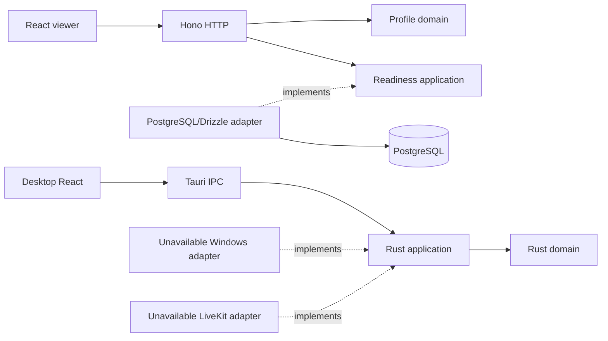

# Architecture

M0 separates HTTP control, UI, and media boundaries. The API is a modular monolith: `profiles` owns pure rules; `system` provides a readiness port and PostgreSQL adapter; `rooms` contains only the initial persistence schema. `src/index.ts` invokes `src/runtime/command.ts`, which dispatches to `src/runtime/server.ts`, which connects the pool, application, and server. Migrations/smoke use measured services in src/runtime; one minimal CLI entry dispatches serve/migrate/smoke/ready. Bun.serve provides native HTTP with graceful drain and an eight-second forced shutdown deadline. There are no room mutation or identity routes.

Code dependencies point toward inner contracts. The Rust domain has no external dependencies; the API domain imports neither Zod, Hono, Drizzle, nor RTC. Tauri instantiates adapters and the use case; no frame travels through IPC/JSON. The server LiveKit SDK appears only in backend smoke. Native RTC SDK/Win32 dependencies enter in M1, using `cfg(target_os = "windows")` where required.

## Contracts

`packages/contracts/src/index.ts` exports TypeScript source and is the source of truth for HTTP DTOs/validation and the TypeScript IPC representation. The API's pure catalog is converted/validated at the HTTP boundary. Drizzle entities never leave the adapter. Rust `AppInfo` serializes `version`, `platform`, and `mediaStatus`; its test compares names/values against a versioned fixture also validated by TS. The Rust IPC test runs in the Windows job. M0 has no broad binding-generation pipeline; changes must update both contracts and the fixture.

## Data and availability

`rooms` has an opaque UUID supplied by the future application, a required nonempty owner, `idle|closed` state, and timestamps. Owner has no identity FK yet; no endpoint treats this ID as authorization. Future updates must explicitly maintain `updated_at`. Generated Drizzle migrations live in `apps/control-api/drizzle`, including journal/snapshot.

Readiness compares expected history hashes with `drizzle.__drizzle_migrations` and queries required `rooms` columns using real database credentials. Missing/divergent migrations, absent schema, and unavailable connection produce 503. The pool has at most five connections, 1.5s connection timeout, 2s query timeout, and 1.5s statement timeout. Startup retries connection five times; the pool/readiness can recover after database return. Migrations use an advisory lock to coordinate this project's runner. Do not run concurrent external migrators.

The API generates request IDs; logs contain event, duration, method, and status, without parameters, headers, bodies, or raw driver errors. SIGINT/SIGTERM stop the server, drain connections, and close the pool within an eight-second deadline.

## Limits

The profile list is static and does not advertise GPU support. Adapters fail with `NotImplemented` on Windows and `UnsupportedPlatform` elsewhere. Engine inspection does not open capture or simulate a session. Media, authentication, invitations, and E2EE remain future milestones.

## Feature-based frontend

Both interfaces follow [frontend.md](frontend.md): mounting/composition in app, exclusive responsibilities in features, public feature APIs, and sharing only with actual reuse. Unit/DOM tests stay near behavior; E2E tests are grouped by feature in tests/e2e. Coverage policy and measured limits are in [testing.md](testing.md).

## Resolution and deployment

App-local aliases are defined in each tsconfig and local TS specifiers are extensionless. TypeScript uses Preserve/Bundler with noEmit; Bun resolves API/test aliases and Vite resolves frontend paths from tsconfig. The architecture checker resolves aliases too, preserving boundaries/cycle checks. Cross-workspace consumers still use public package exports.

The API runs source TypeScript on Bun by default. Optional Bun compile produces a single host executable with embedded SQL/meta assets and Bun runtime. Source migration lookup remains relative to its adapter; standalone lookup uses embedded assets under import.meta.dir. Drizzle history/hash/constraints/readiness semantics remain unchanged. Docker ships the standalone binary without JS bundles, Node, or node_modules. Runtime-specific Bun APIs stay outside pure domain/application rules.

## M1 implementation slice

The product API still exposes only the M0 control endpoints. Offline operator tooling creates allowlisted five-minute room-scoped proof grants in new private files; it is not mounted as an HTTP route. Client grant schemas live in contracts; the operator-only allowlist schema stays with the tooling boundary. See ADR 0011 and media-proof.md.

The viewer's opt-in receiver dynamically loads its SDK only after explicit consent/submission, configures the actual encryption worker before connection, and manually subscribes to one encrypted designated publisher track only after validating connected identity/room. No browser publishing or automatic reconnect exists. Native sharing remains disabled in IPC.

The portable Rust session controller uses a trusted monotonic clock and verified authorization port, guards every blocking transition with fresh deadlines, and keeps one immutable selected source/session/epoch. It reports cleanup failures and requires release before reuse. A one-pending-frame queue drops/reclaims replaced native buffers. EncodedAccessUnit bounds H.264 Annex B framing with SPS/PPS before IDR; it does not decode or prove codec compatibility.

The target-specific Windows acquisition module preserves the exact system-picker GraphicsCaptureItem, uses a hardware D3D11 device and two-frame WGC pool, copies selected content into owned GPU textures, and recreates the same pool/item on resize. It is compile-checked and unwired, with per-frame allocation/copy and no hardware-performance claim. D3D11 conversion, asynchronous hardware Media Foundation encoding and an optional native encrypted LiveKit adapter now have implementation. The explicit apps/media-proof-native utility composes them on STA/MTA owner threads; full Windows runtime/hardware validation and regular product-shell integration remain pending M1 work.
