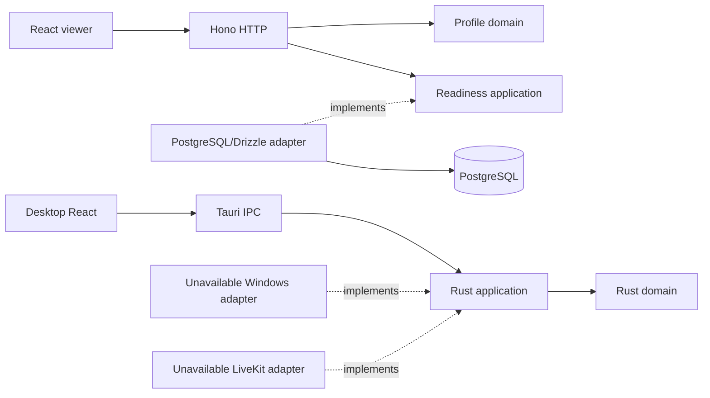

# Architecture

M0 separates HTTP control, UI, and media boundaries. The API is a modular monolith: `profiles` owns pure rules; `system` provides a readiness port and PostgreSQL adapter; `rooms` contains only the initial persistence schema. `src/index.ts` composes configuration and delegates to `src/runtime/server.ts`, which connects the pool, application, and server. Migrations/smoke use measured services in `src/runtime` with minimal CLI wrappers. There are no room mutation or identity routes.

Code dependencies point toward inner contracts. The Rust domain has no external dependencies; the API domain imports neither Zod, Hono, Drizzle, nor RTC. Tauri instantiates adapters and the use case; no frame travels through IPC/JSON. The server LiveKit SDK appears only in backend smoke. Native RTC SDK/Win32 dependencies enter in M1, using `cfg(target_os = "windows")` where required.

## Contracts

`packages/contracts/src/index.ts` is the source of truth for HTTP DTOs/validation and the TypeScript IPC representation. The API's pure catalog is converted/validated at the HTTP boundary. Drizzle entities never leave the adapter. Rust `AppInfo` serializes `version`, `platform`, and `mediaStatus`; its test compares names/values against a versioned fixture also validated by TS. The Rust IPC test runs in the Windows job. M0 has no broad binding-generation pipeline; changes must update both contracts and the fixture.

## Data and availability

`rooms` has an opaque UUID supplied by the future application, a required nonempty owner, `idle|closed` state, and timestamps. Owner has no identity FK yet; no endpoint treats this ID as authorization. Future updates must explicitly maintain `updated_at`. Generated Drizzle migrations live in `apps/control-api/drizzle`, including journal/snapshot.

Readiness compares expected history hashes with `drizzle.__drizzle_migrations` and queries required `rooms` columns using real database credentials. Missing/divergent migrations, absent schema, and unavailable connection produce 503. The pool has at most five connections, 1.5s connection timeout, 2s query timeout, and 1.5s statement timeout. Startup retries connection five times; the pool/readiness can recover after database return. Migrations use an advisory lock to coordinate this project's runner. Do not run concurrent external migrators.

The API generates request IDs; logs contain event, duration, method, and status, without parameters, headers, bodies, or raw driver errors. SIGINT/SIGTERM stop the server, drain connections, and close the pool within an eight-second deadline.

## Limits

The profile list is static and does not advertise GPU support. Adapters fail with `NotImplemented` on Windows and `UnsupportedPlatform` elsewhere. Engine inspection does not open capture or simulate a session. Media, authentication, invitations, and E2EE remain future milestones.

## Feature-based frontend

Both interfaces follow [frontend.md](frontend.md): mounting/composition in app, exclusive responsibilities in features, public feature APIs, and sharing only with actual reuse. Unit/DOM tests stay near behavior; E2E tests are grouped by feature in tests/e2e. Coverage policy and measured limits are in [testing.md](testing.md).
