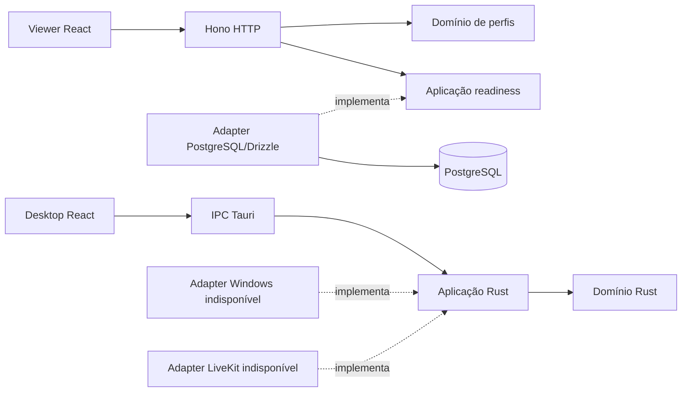

# Arquitetura

M0 separa controle HTTP, UI e fronteiras de mídia. A API é um monólito modular: `profiles` mantém regras puras; `system` fornece a porta de readiness e o adapter PostgreSQL; `rooms` possui somente o schema inicial de persistência. `src/index.ts` compõe configuração e delega a `src/runtime/server.ts`, que conecta pool, aplicação e servidor. Migrations e smoke possuem serviços medidos em `src/runtime`, com wrappers CLI mínimos. Não existem rotas de mutação de salas ou identidade.

Linhas de dependência do código apontam para contratos interiores: o domínio Rust não tem dependências externas e o domínio da API não importa Zod, Hono, Drizzle ou RTC. Tauri instancia os adapters e o caso de uso; nenhum frame é transferido por IPC/JSON. O SDK LiveKit de servidor aparece somente no smoke backend. SDK RTC nativo e dependências Win32 entram apenas em M1, com `cfg(target_os = "windows")` quando necessárias.

## Contratos

`packages/contracts/src/index.ts` é a fonte de verdade dos DTOs e validações HTTP e da representação TypeScript do IPC. O catálogo puro da API é convertido/validado na fronteira HTTP. As entidades Drizzle não saem do adapter. Para IPC, `AppInfo` Rust serializa `version`, `platform` e `mediaStatus`; o teste Rust compara nomes/valores com uma fixture versionada e o teste TS valida a mesma fixture. O teste Rust de IPC roda no job Windows. Não há geração ampla de bindings em M0; mudanças precisam atualizar ambos os contratos e a fixture.

## Dados e disponibilidade

`rooms` possui UUID opaco fornecido pela aplicação futura, proprietário obrigatório não vazio, estado `idle|closed` e timestamps. O proprietário ainda não possui FK de identidade; não há endpoint que aceite esse identificador como autorização. Atualizações futuras devem manter `updated_at` explicitamente. Migrações geradas por `drizzle-kit generate` ficam em `apps/control-api/drizzle`, incluindo journal/snapshot.

Readiness compara hashes do histórico esperado com `drizzle.__drizzle_migrations` e consulta as colunas necessárias de `rooms`, usando usuário/senha reais do banco. Migrations ausentes/divergentes, schema ausente e conexão indisponível causam 503. O pool tem no máximo cinco conexões, timeout de conexão 1,5s, query 2s e statement 1,5s. O startup tenta conectar cinco vezes; o pool e a readiness continuam capazes de recuperar após o banco voltar. Migrations têm advisory lock para coordenar o runner do projeto. Não execute migradores externos concorrentes.

A API gera request IDs próprios; logs incluem evento, duração, método e status, sem parâmetros, headers, corpo ou erros brutos do driver. SIGINT/SIGTERM param o servidor, drenam conexões e fecham o pool; há prazo de oito segundos.

## Limites

A lista de perfis é estática; não anuncia suporte de GPU. Os adapters falham com `NotImplemented` no Windows e `UnsupportedPlatform` em outros sistemas. A verificação do motor não abre captura nem simula uma sessão. Toda mídia, autenticação, convites e E2EE permanecem nos próximos marcos.

## Frontend por funcionalidade

As duas interfaces seguem [docs/frontend.md](frontend.md): montagem/composição em `app`, responsabilidades exclusivas em `features`, API pública por feature e compartilhamento somente com uso real. Testes unitários e DOM ficam próximos ao comportamento; testes E2E são organizados por feature em `tests/e2e`. A política e os limites medidos estão em [testing.md](testing.md).
